<div align="center">

  <a href="https://github.com/morpheuscs">
    
  </a>

  <br />

  

</div>

---

### `// ARSENAL & STACK`

<div align="center">

  
  
  
  
  
  
  
  
  
  

</div>

---

### `// CAPABILITIES`

```yaml
[0x01] NETWORK & INFRASTRUCTURE  :: Packet Analysis · Recon · Firewalls · Linux Hardening
[0x02] APPLICATION SECURITY      :: Web & API Auditing · Code Review · Auth Architecture
[0x03] SYSTEMS & LOW-LEVEL       :: C / C++ · Memory Internals · Linux Process Control
[0x04] AUTOMATION & DATA         :: Python Tooling · Bash / Zsh Pipelines · SQL Queries
```

---

<div align="center">
  <sub><code>"The quieter you become, the more you are able to hear."</code></sub>
  <br /><br />
  
</div>
